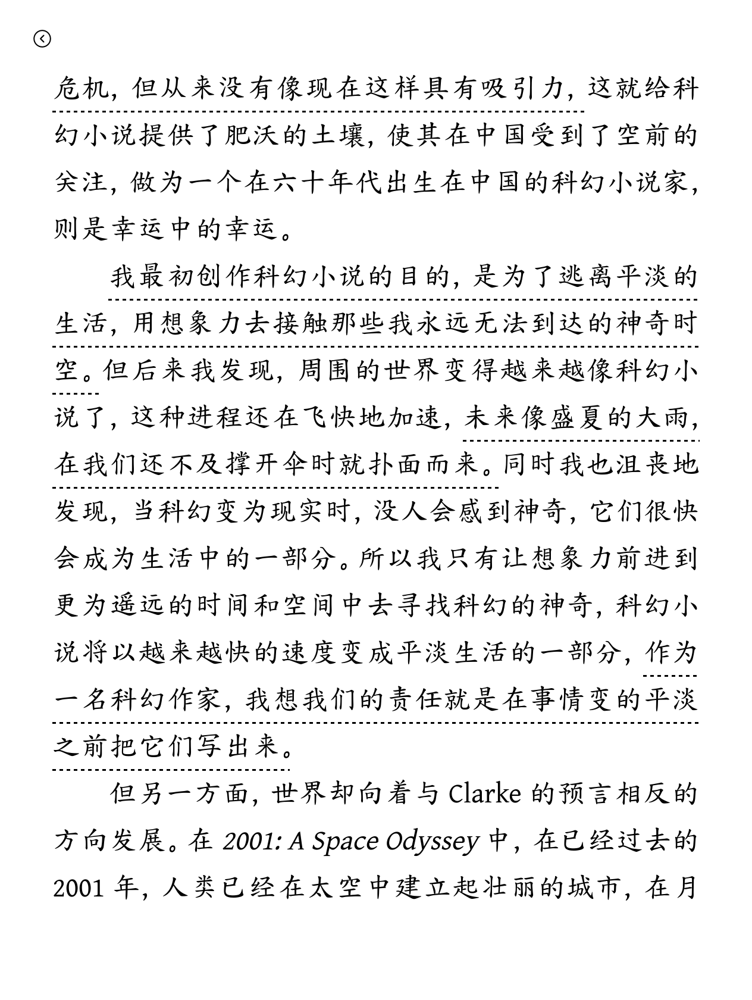
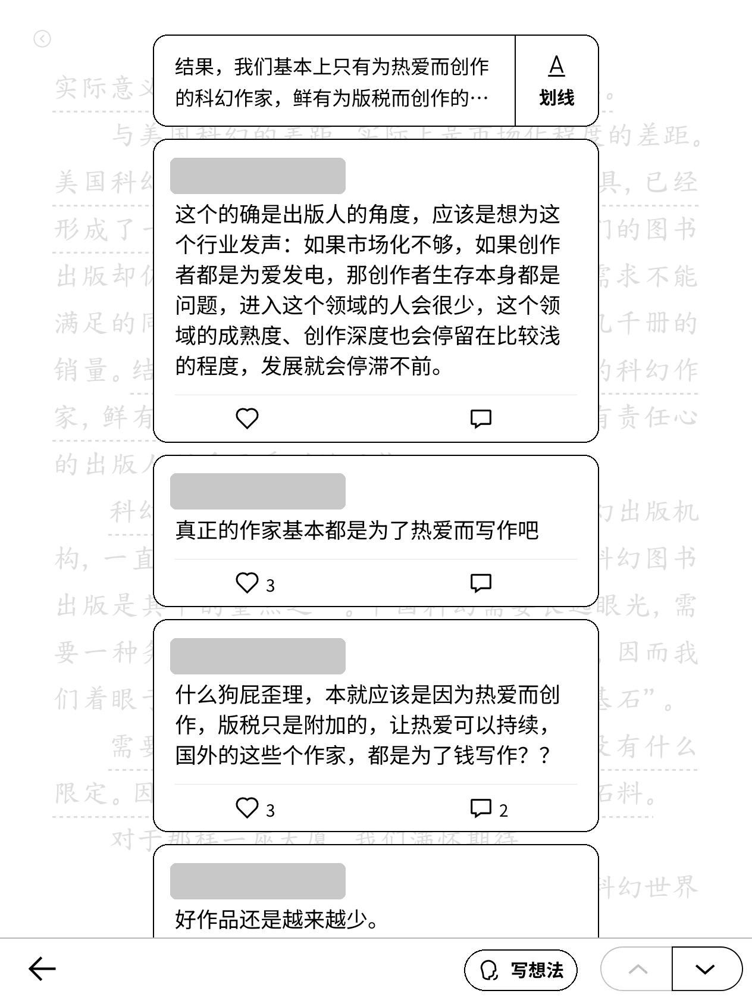
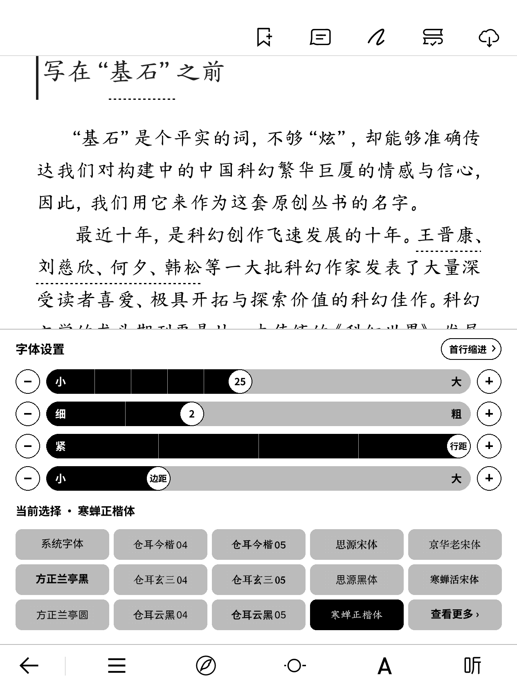
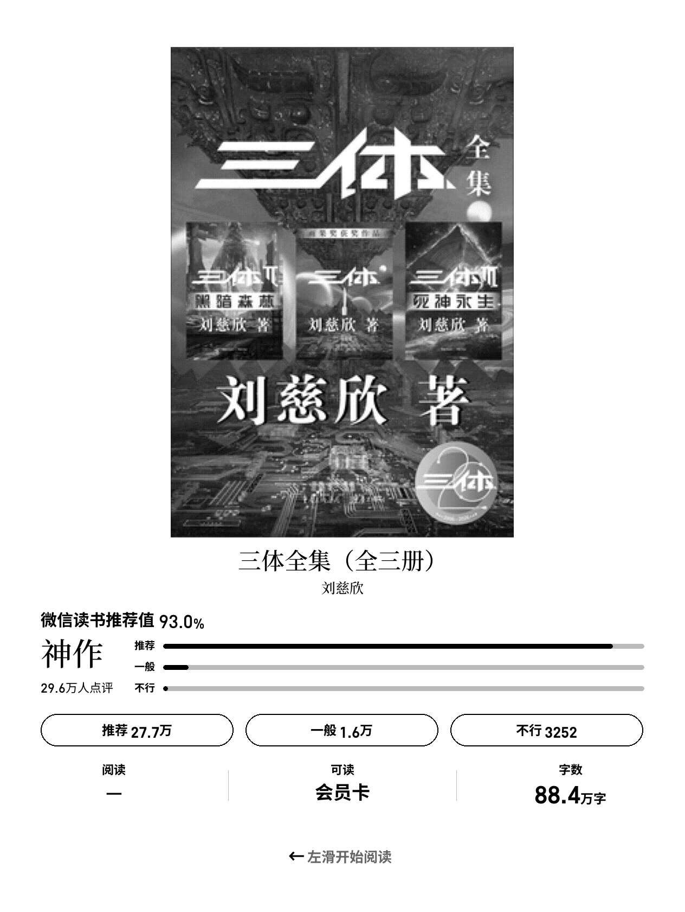

# weread-kindle

在 Kindle 上运行的**非官方**微信读书墨水屏客户端，基于 [KOReader](https://github.com/koreader/koreader) 的底层，界面和交互照着官方墨水屏版 2.1.2 做。

> Unofficial WeRead (微信读书) e-ink client for Kindle, running on top of KOReader. For personal study only. You need your own WeRead account.

## 功能

- 微信扫码登录、书架（含分组、下载、私密阅读）、书城、搜索、书籍详情
- 阅读：翻页、目录、字体和排版设置、划线、想法、书签、热门划线、书友想法、进度同步
- 我的：阅读时长、笔记、书单
- 息屏时显示当前在读书的介绍页
- 网络请求都在后台进行，翻页约 0.13 秒，打开书、评论不卡界面；可以随时点左上角返回取消打开

## 截图

| 书架 | 书城 | 阅读（带热门划线） |
|---|---|---|
|  |  |  |

| 书友想法（昵称头像已遮挡） | 字体设置 | 息屏页 |
|---|---|---|
|  |  |  |

## 前置条件

| 需要 | 说明 |
|---|---|
| Kindle | 作者只在 **Kindle Oasis 3（固件 5.18 系列）** 上测过。界面坐标按 1264×1680 的屏幕写，其他分辨率的设备会错位 |
| 越狱 | Kindle 需要已经越狱，能运行第三方程序 |
| KOReader | 装在 `/mnt/us/koreader`。本项目借用它的 LuaJIT、屏幕和字体库，不能缺 |
| 微信读书账号 | 用微信扫码登录。**墨水屏设备同一时间只能登录一台**，登录后官方墨水屏 App 会被挤下线 |
| 网络 | Kindle 要能连 Wi-Fi，直接访问 `i.weread.qq.com` |
| 一台电脑 | 用来拷贝文件。Mac / Linux 直接用下面的脚本，Windows 手动拷贝即可 |

## 安装（USB，最简单）

1. 用数据线把 Kindle 连到电脑，确认能看到 `documents` 和 `koreader` 两个文件夹。
2. 克隆本仓库，运行：
   ```sh
   git clone https://github.com/<你的用户名>/weread-kindle.git
   cd weread-kindle
   tools/install-usb.sh /Volumes/Kindle
   ```
   手动安装的话：把 `kindle/` 里的 `main.lua`、`weread/`、`launcher/`、`fonts/` 拷到 Kindle 的 `weread/` 目录，再把 `kindle/launcher/weread.sh` 拷到 `documents/`。
3. 推出 Kindle。书库里会出现“微信读书”，点开即可。第一次启动会自动生成启动脚本。
4. 打开后选择微信登录，用手机微信扫屏幕上的二维码。

### 字体

仓库带了思源黑体（WR Sans）、思源宋体和微信读书的数字字体。**方正兰亭黑**是商业字体，没有放进来：选了它但没有文件时，会显示成“未下载”。需要的话自己把 `FZLTHProGBK-DB.ttf` 放到 `kindle/fonts/` 再安装。
其他字体在 App 的字体面板里点一下就会联网下载。

## 开发

需要 Kindle 上开着 SSH（dropbear，端口 2222，密钥登录）：

```sh
# 打开 SSH 的标记：tools/deploy.sh 会自动创建 /mnt/us/weread/dev.ssh，之后每次启动应用都会开 SSH
export KINDLE_IP=<Kindle 的 IP>      # 或运行 tools/kfind 自动找
tools/deploy.sh      # 部署
tools/krun           # 热重启应用
tools/kshot out.png  # 截图
tools/ktap tap x y   # 远程点击（也有 key / swipe / hold）
```

默认不开 SSH；只有放了 `/mnt/us/weread/dev.ssh` 才会开，而且只认密钥。日志在 Kindle 的 `/mnt/us/weread/crash.log`，性能日志搜 `weread perf`。

目录：

```
kindle/main.lua          入口
kindle/weread/           全部界面和逻辑（Lua）
kindle/launcher/         书库入口脚本和 run.sh 生成脚本
kindle/fonts/            字体
direct/weread_direct.py  在电脑上验证接口的 Python 原型（pip install -r requirements.txt）
tools/                   部署、截图、远程操作、素材裁切等脚本
```

## 已知问题

- 评论卡片第一次打开会整屏闪一下
- 写想法、划线、点赞这些操作还是同步请求，网络慢时会停顿一下
- 不支持：听书、查词、涂鸦、全书搜索、微信文章

## 免责声明

本项目与腾讯无关，仅供个人学习研究，请勿用于商业用途或批量抓取。使用风险自负，账号被限制与作者无关。
第三方内容和许可证见 [NOTICE.md](NOTICE.md)。作者自己写的代码使用 MIT 许可证。
